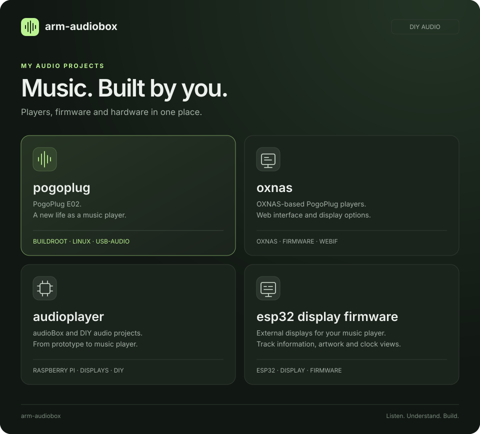

<!-- GitHub profile README for arm-audiobox. Artwork follows the PogoPlug WebIF design. -->

# Welcome to arm-audiobox

My home for DIY audio projects: Linux music players, custom firmware, displays and hardware. The aim is to give existing devices a new purpose and build music players for the home network.

## Projects

| Directory | Focus |
| :--- | :--- |
| [pogoplug](pogoplug/README.md) | PogoPlug E02 music players based on Buildroot and Linux, with USB audio and a web interface. |
| [oxnas](oxnas/README.md) | OXNAS-based PogoPlug players, including platform-specific firmware and optional display integration. |
| [audioplayer](audioplayer/README.md) | audioBox and other audio player projects, including Raspberry Pi players and related hardware. |
| [esp32-display-firmware](esp32-display-firmware/README.md) | ESP32 firmware for external player displays, with build, flashing and connection documentation. |

## Network audio

Depending on the project, playback uses **Squeezelite / Lyrion Music Server**, **AirPlay** or **DLNA / UPnP**. Supported services, displays and audio devices are documented separately for each platform.

## Source and documentation

The project directories are prepared for source code, build instructions, configuration examples and hardware notes. Firmware and release instructions will be documented with their respective projects as they are added.

All documentation is written in **English**. Directory names use **lowercase**.

---

**arm-audiobox** · Listen. Understand. Build.
