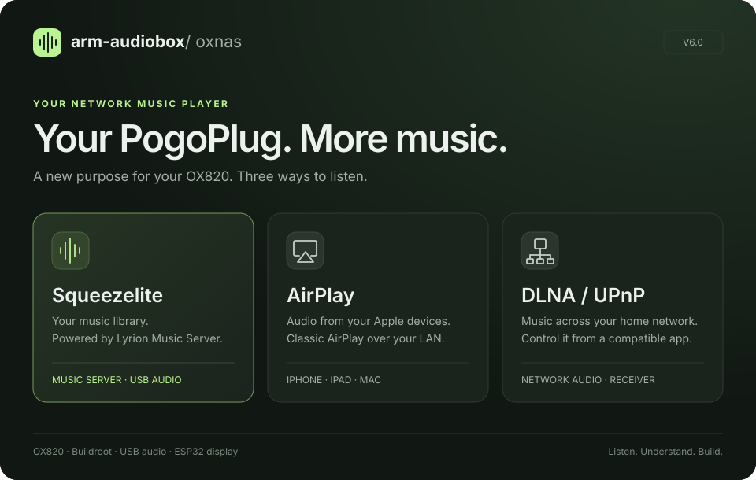

> [!WARNING]
> **NO WARRANTY — 230 V MAINS VOLTAGE — RISK OF BRICKING**
>
> This software, firmware, image and documentation are provided **“AS IS”, without warranty of any kind**. We accept no liability for damage, data loss or an unusable device, to the extent permitted by applicable law. Use entirely at your own risk.
>
> **The device operates from 230 V AC mains. Its internal power supply can cause fatal electric shock.** Do not open the enclosure or work on internal wiring while connected to mains. Disconnecting power does not guarantee that internal components are safe to touch. Hardware servicing must be left to a qualified person. The USB installation below does not require opening the enclosure.
>
> **Incorrect images, bootloader settings, NAND writes or interrupted flashing can permanently brick the device.** Writing an image to the wrong drive will destroy its data. Verify the exact hardware and destination drive and have a recovery plan before proceeding.



# PogoPlug OXNAS player V6.0

A Buildroot/Linux network music player image for **PogoPlug OX820 / ARMv6 hardware with 128 MiB RAM**. This is not a PogoPlug E02/Kirkwood image.

[Download](#download-and-contents) · [Installation](#before-installation) · [USB display](#optional-esp32-usb-display) · [Validation](#validation-status) · [All projects](../README.md)

## Download and contents

| File | Purpose |
| :--- | :--- |
| [pogo-oxnas-v6.0-ext2-100MB.img.gz](pogo-oxnas-v6.0-ext2-100MB.img.gz) | Compressed whole-drive USB image. Decompress before using the commands below. |
| [SHA256SUMS](SHA256SUMS) | SHA-256 checksum of the compressed download. |
| [image-verification.json](image-verification.json) | Source provenance, raw/compressed hashes and filesystem verification. |

The uncompressed image is exactly **100,000,000 bytes**. It contains a DOS/MBR partition table and one ext2 partition beginning at sector 2048. The partition does not automatically expand to fill a larger USB drive.

The public copy has had the development environment's preconfigured SSH `authorized_keys` file removed. It contains no replacement access key; configure your own key as described below. Its checksum therefore differs from the original build-machine image. The source SHA-256 and the modified image SHA-256 are recorded in the verification file.

## Features

- Squeezelite for Lyrion / Logitech Media Server.
- Classic AirPlay and DLNA/UPnP receiver modes.
- Web interface for playback service selection, configuration and status.
- Configuration backup/restore and signed application updates.
- USB audio and optional ESP32 display support.
- Display selection for Waveshare ESP32-C6 1.47-inch and ESP32-WROOM-32 1.96-inch.

Only one playback receiver is selected at a time. Squeezelite starts after a reboot. AirPlay metadata and artwork depend on the sending application; DLNA artwork is not integrated in this release.

## Before installation

You need:

- The correct OX820-based PogoPlug model; check the hardware rather than relying on the case colour.
- A USB drive larger than the uncompressed image, whose contents may be erased.
- An Ethernet connection to a trusted local network with DHCP.
- A compatible USB audio device and, for Squeezelite, a reachable music server.
- **An existing, working boot method for this kernel and USB root filesystem.**

### Bootloader prerequisite

**Writing the USB image alone does not enable USB boot on a stock device.** Stock OXNAS U-Boot 1.1.2 requires a network-loaded kernel or a separately installed and configured compatible bootloader. This image does not install or update U-Boot.

Before writing the USB drive, confirm how your particular device will load the kernel, select the USB root filesystem and recover from a failed boot. Do not use E02/Kirkwood U-Boot binaries or copy bootloader environment commands from another model.

The supplied image is intended for a device with that boot path already prepared. Initial stock-bootloader conversion and NAND installation require a separate, model-specific procedure; they are not performed by this guide. No NAND image or bootloader is included here.

Back up your existing system, settings and bootloader environment before making changes. A WebIF configuration backup does not back up NAND or the bootloader.

## 1. Download and verify

Download the compressed image, checksum file and verification file into the same directory. If using a repository checkout:

```sh
cd arm-audiobox/oxnas
```

On macOS:

```sh
shasum -a 256 -c SHA256SUMS
```

On Linux:

```sh
sha256sum -c SHA256SUMS
```

Continue only if the result is `OK`.

Decompress while keeping the download:

```sh
gzip -dk pogo-oxnas-v6.0-ext2-100MB.img.gz
```

Check the uncompressed size:

```sh
wc -c < pogo-oxnas-v6.0-ext2-100MB.img
```

The result must be `100000000`. You can also compare the raw image's SHA-256 against `image_sha256` in `image-verification.json`:

```sh
# macOS
shasum -a 256 pogo-oxnas-v6.0-ext2-100MB.img

# Linux
sha256sum pogo-oxnas-v6.0-ext2-100MB.img
```

## 2. Write the whole USB drive

**This erases the destination drive.** Identify the USB drive by model, size and connection. Use the whole drive, not one of its partitions. The placeholders below must be replaced deliberately; never copy another machine's drive identifier.

### Linux

List disks and mounted partitions:

```sh
lsblk -o NAME,SIZE,MODEL,TRAN,MOUNTPOINTS
```

Unmount every mounted partition on the chosen USB drive using your desktop's disk utility or `umount`. Replace `/dev/sdX` below with the verified whole-drive device; do not use a partition such as `/dev/sdX1`.

```sh
sudo dd if=pogo-oxnas-v6.0-ext2-100MB.img of=/dev/sdX bs=4M conv=fsync status=progress
sync
```

Safely eject the drive after the command completes.

### macOS

Identify the drive:

```sh
diskutil list external physical
```

Replace `N` in both commands with the verified disk number. `/dev/diskN` and `/dev/rdiskN` must refer to the same external USB drive.

```sh
diskutil unmountDisk /dev/diskN
sudo dd if=pogo-oxnas-v6.0-ext2-100MB.img of=/dev/rdiskN bs=4m
sync
diskutil eject /dev/diskN
```

Press Ctrl+T during `dd` to display progress. macOS does not natively mount ext2; if it offers to initialise or erase the written drive, cancel that prompt.

### Windows

Use a raw disk image writer to write the decompressed `.img` to the verified whole USB drive. Select the custom image and destination carefully, enable write verification where available, and safely eject when finished. Cancel any prompt to format the ext2 partition.

## 3. Boot and find the player

1. With the PogoPlug powered down and unplugged, connect the prepared USB drive, Ethernet and USB audio device.
2. Reconnect power with the enclosure closed and intact.
3. Use the previously configured compatible boot method. A stock device without that setup will not automatically boot this image.
4. Look up the Ethernet DHCP lease in your router. The image's default hostname is `pogo-oxnas`.
5. Open `http://PLAYER_IP/` in a browser, replacing `PLAYER_IP` with the assigned address. Do not assume a fixed IP address or that hostname resolution is available.

If boot fails, return to your documented recovery procedure. Repeatedly changing NAND partitions or U-Boot settings without confirming the cause can make recovery harder.

## 4. Configure playback and access

Use the WebIF settings to configure the hostname, player names, music server and ALSA audio device. The image defaults to audio device `default` and music server `lms.lan`; change the server to your own address or use the supported discovery setting. The preset timezone is `Europe/Berlin`.

Select Squeezelite, AirPlay or DLNA on the music page and test playback. After confirming operation, export a configuration backup and store it privately.

### Set up your own SSH key

SSH uses **public-key authentication only**. The public image intentionally has no preconfigured authorised user key. In WebIF settings, add your own **public** SSH key and save it before attempting SSH access. Never paste a private key into the WebIF.

After adding your key, connect as root using the corresponding private key on your computer:

```sh
ssh -i /path/to/your/private_key root@PLAYER_IP
```

### Trusted network only

The WebIF has no login and can change settings and authorised SSH keys. Use it only on a trusted local network. Do not forward its HTTP or SSH ports from the Internet. Review your SSH keys before restoring a settings backup, because a restore replaces the authorised-key list.

## Optional ESP32 USB display

See [ESP32 display firmware](../esp32-display-firmware/README.md) for board-specific sources, installation and flashing instructions.

Use firmware for the exact display model. The player image version is 6.0, while the compatible display firmware identifies itself as P5 5.3. Reflashing a working compatible display solely to match the player image version is unnecessary.

Enable the display in the WebIF and select the matching connected device. The bridge supplies the display with time, metadata and artwork. Display support depends on the host kernel, USB interface and board configuration.

## Backups and updates

Use the WebIF's **Backup & update** page to export settings. A settings backup is not a full disk image and does not contain the bootloader.

For WebIF application updates, use only a matching, signed `.pogoupdate` package. **Do not upload this `.img.gz` or its decompressed `.img` to the Web updater.** Application updates do not replace U-Boot, the kernel or the full root filesystem.

## Validation status

The source release includes emulated ARM program checks and offline USB-image checks. A live application update to V6 was checked on an existing OXNAS installation; that is not a clean boot test of this complete image.

For this public copy, the preconfigured SSH key file was removed, the ext2 filesystem passed `e2fsck -fn`, and both compressed and decompressed SHA-256 hashes were verified after transfer.

**This complete public USB image has not been physically boot-tested.** Waveshare C6 operation on OXNAS also remains unconfirmed by the source release's hardware report. Treat those as outstanding hardware checks rather than assuming that a successful build proves hardware operation.

## Electrical safety reference

For general advice on unplugging equipment before maintenance and using a qualified repair technician, see [Electrical Safety First](https://www.electricalsafetyfirst.org.uk/safety-advice/home-and-people/house-maintenance/fire-prevention-tips/). This image-writing guide does not require internal hardware work.

---

**arm-audiobox · oxnas** · Listen. Understand. Build.

[Back to arm-audiobox](../README.md)
