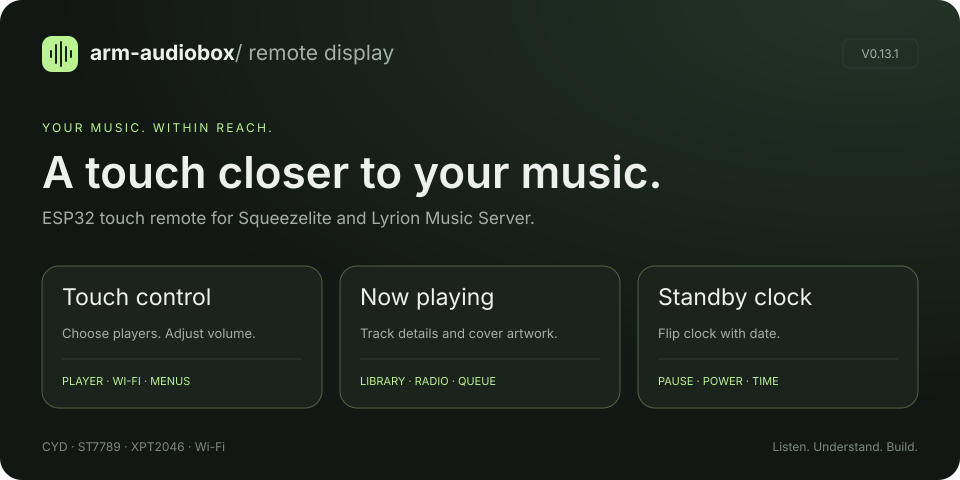

# Squeezelite ESP32 remote display

A Wi-Fi touch remote for **Lyrion Music Server (LMS)** and its Squeezelite players. Version **0.13.1** runs on the **ESP32-2432S028 USB-C Cheap Yellow Display with ST7789**. The ESP32 controls playback; audio is played by the selected LMS player.

## Hardware

- ESP32-D0WD-V3, 4 MB flash; PSRAM is not required.
- ST7789 display, 320 × 240 landscape, with XPT2046 resistive touch.
- This release was tested on the USB-C ST7789 variant. CYD boards with an ILI9341 require different display initialization; the included binaries are for ST7789 only.

## Features

- Cover artwork on the right, track information on the left.
- All operating menus are overlays over the playback screen, including browsing, queue, language, settings and item actions. Setup and touch calibration remain full-screen.
- Player selection, vertical volume and Wi-Fi status overlays in the header. Back controls are on the right; the menu close icon is on the left.
- Native-resolution overlay text with wrapping or truncation instead of shrinking.
- Saved display brightness (5–100%) and a daily night-dimming schedule with adjustable start time, end time and night brightness.
- Previous/next track arrows, play/pause and browsing with folder action menus.
- Player-specific LMS / Material Skin home menus and pinned favorites.
- Radio station information for streams; track number and playlist total for playlists.
- German and English menu translations in `locale/*.po`; LMS media and player information retain the language received from the server.
- Configurable menu and overlay timeout: 0 disables it, 1–3600 seconds enables it. Touch outside an overlay returns to playback.
- Standby powers off the selected LMS player. Standby or pause shows a flip clock with date after 10 seconds without interaction. Touch wakes the display without resuming audio.
- Time comes from the LMS HTTP response, with Europe/Berlin daylight-saving rules.

The application keeps the tested build identifier `0.13.1-overlay-test`; the repository images contain exactly the application approved on the display. The project page uses the green PogoPlayer artwork style. The supplied firmware is the tested display build; its display colors are unchanged by this repository export.

## Ready-to-flash firmware

All files are in [firmware](firmware/). Use esptool 5.x and replace `PORT` with the actual serial port, for example `/dev/cu.wchusbserial2040` on the development Mac. Close any serial monitor first.

**First installation:** the factory image contains bootloader, partition table, boot-app data and application. It overwrites the settings area, so Wi-Fi and touch calibration must be configured again.

```sh
esptool --chip esp32 --port PORT --baud 460800 write-flash 0x0 firmware/cyd-st7789-v0.13.1-factory.bin
```

**Update an existing installation of this project:** application only; keeps the existing settings and calibration when used with the same partition layout.

```sh
esptool --chip esp32 --port PORT --baud 460800 write-flash 0x10000 firmware/cyd-st7789-v0.13.1-update.bin
```

Earlier v0.11 factory/update images are retained for reference; use the v0.13.1 commands above for the current version.

Checksums and flash offsets are listed in `firmware/SHA256SUMS` and `firmware/manifest.json`. These are compiled build files, not a device backup; no stored Wi-Fi password is included.

## Setup

1. Connect to the open `LMS-Remote` Wi-Fi access point.
2. Open `http://192.168.4.1` and enter Wi-Fi credentials and the LMS server's **IP address or DNS name**, without scheme or port. The default is `lms.lan`; LMS port is 9000.
3. The remote stores these settings locally. `.lan` is resolved through the network DNS server; it is not an mDNS suffix. The remote also advertises `lms-remote.local` where mDNS is available.
4. Open the player overlay to select an LMS player. Calibrate touch from Settings or with a short BOOT press; hold BOOT for 2.5 seconds to open Wi-Fi setup.

This project currently includes the development PogoPlug E02 player ID as a first-boot preset and its six-entry Material home-menu customization. Other installations should select their own player after setup. The relevant presets are in `src/main.cpp` (`e02preset`, `e02menuset`).

## Build from source

Install PlatformIO Core, then run from this directory:

```sh
pio run -e cyd-st7789
pio run -e cyd-st7789 -t upload --upload-port PORT
```

PlatformIO pins the platform and libraries in `platformio.ini` and generates translations from the PO catalogs before compiling. The resulting application is `.pio/build/cyd-st7789/firmware.bin`.

## Display brightness and night dimming

Open **Device → Settings** from the home menu. Brightness changes immediately and is stored locally. Back is on the right; outside touch or the configured timeout closes the overlay to playback.

**Night dimming** defaults to enabled, **22:00–07:00 at 10%**, using the same local Europe/Berlin clock as the flip clock. Start/end, enabled state and night brightness are stored across restarts. Summer/winter time follows the local clock automatically.

- Use separate up/down buttons for hours and minutes. Holding an arrow repeats the adjustment. Save is on the left; Back is on the right.
- Back or timeout discards an unconfirmed time adjustment. Start and end must differ. Intervals can cross midnight.
- Night brightness uses a vertical slider with a live preview. The normal brightness slider also previews its own value while editing.
- Outside the night interval, the normal brightness returns automatically. Night mode never raises brightness above the normal setting.
- Scheduling begins once the device has a valid synchronized clock. It applies to playback, menus and the flip clock.

## Verification

Version 0.13.1 was compiled and flashed successfully, then approved on the display. Device checks through the diagnostic touch handler covered overlay navigation, right-side Back, saved brightness, night-schedule enable/disable, actual dimming in a temporary current-time window and restoration of normal brightness outside it. Arrow input, saving, cancellation and timeout were checked. The original settings and player state were restored afterward.

Native tests cover all 1,440 minutes for both overnight and daytime intervals, disabled and unsynchronized schedules, brightness limits and hour/minute wraparound. Translation catalog tests pass. Holding/repeating arrows and physical dragging should be checked on the actual calibrated touch panel when using different hardware.

```sh
python3 tests/test_translations.py
c++ -std=c++11 -Isrc tests/night_dimming_test.cpp -o /tmp/remote-night-test
/tmp/remote-night-test
c++ -std=c++11 -Isrc tests/overlay_layout_test.cpp -o /tmp/remote-overlay-test
/tmp/remote-overlay-test
```

Additional native tests and recorded LMS menu fixtures are in `tests/`. See [CHANGELOG.md](CHANGELOG.md) for recent changes and [README.txt](README.txt) for a German quick guide.
